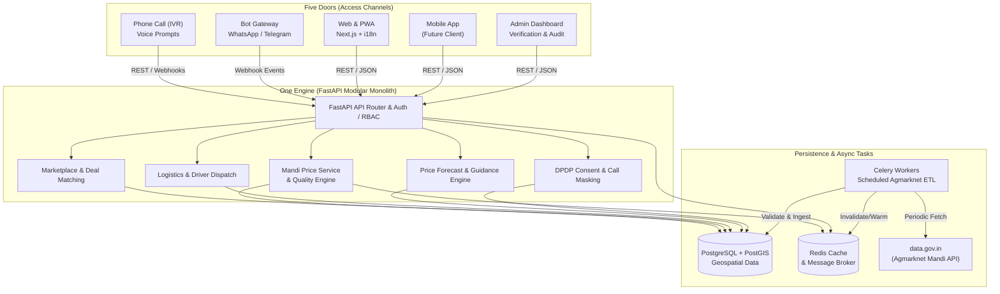
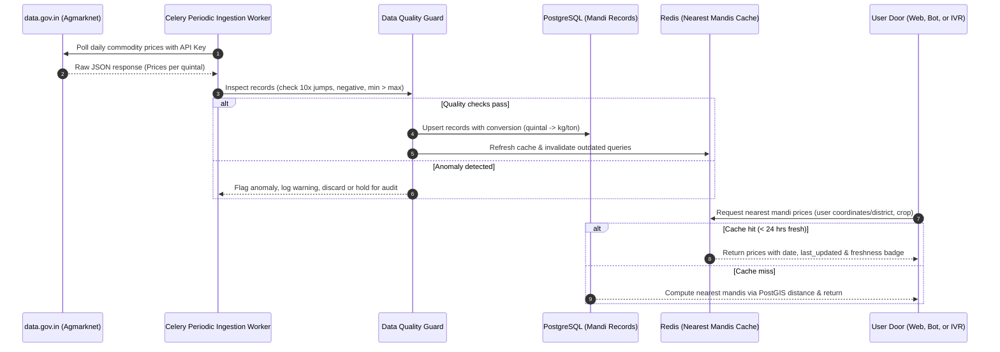

# GrowCircle System Architecture

GrowCircle is built upon a **modular monolith** paradigm designed around the philosophy: **"One engine, five doors"**.

---

## 1. The One Engine, Five Doors Concept

Every user-facing channel ("door") communicates with the exact same unified FastAPI application ("engine"). Business rules, mandi price normalization, data validation, DPDP consent checks, and RBAC logic are enforced in a single place.

---

## 2. End-to-End Data Flow: Mandi Price Ingestion & Consumption

---

## 3. Why a Modular Monolith?

### Decision Context
In early and high-growth stages of product development, microservices introduce excessive overhead: distributed tracing, eventual consistency challenges, duplicated schemas, network latency between internal services, and complex deployments.

### Guiding Principles:
1. **Single Source of Truth**: All five doors need identical validation for phone masking, crop units, and permissions. A shared codebase ensures zero divergence between the IVR prompt and the Web app.
2. **PostgreSQL + PostGIS**: Enables high-performance geospatial queries (calculating the 3 nearest mandis or drivers to a latitude/longitude point) with transaction safety.
3. **Internal Domain Boundaries**: Although deployed as a single application, code is organized into isolated domain packages (`mandi`, `marketplace`, `logistics`, `privacy`, `forecast`) with strict boundaries. If scaling demands separating a service (e.g. ML inference), the boundary is already clean.
