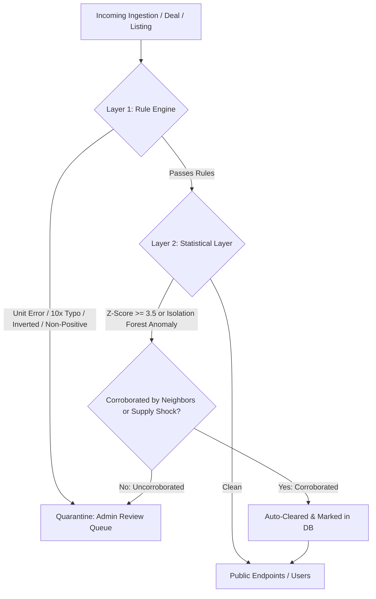

# Model Card: Multi-Layer Anomaly Detection for Mandi Prices, Deals, and Source Outages

## 1. Model Details
- **Model Name**: GrowCircle Multi-Layer Anomaly Detection System (`anomaly_engine_v1`)
- **Version**: 1.0.0
- **Model Type**: Hybrid Multi-Layer Architecture (Deterministic Rule Guard + Robust Z-Score on Forecast Residuals + Per-Crop Scikit-Learn Isolation Forest + Spatial/Supply Shock Auto-Clearing Heuristics + Reporting Outage Statistical Baseline)
- **Release Date**: October 2026
- **License**: Proprietary (GrowCircle Open AgTech Platform)
- **Primary Maintainer**: GrowCircle Machine Learning & Trust & Safety Team

---

## 2. Intended Use & Workflow
- **Intended Use**:
  - Intercepting erroneous, anomalous, or fraudulent agricultural data before it reaches farmers, buyers, or consumers.
  - Quarantining flagged records into an **Admin Review Queue** where human operators can audit reasons and either approve (releasing to users) or reject (permanently hiding).
  - Automatically clearing statistically anomalous records that are corroborated by real-world physical phenomena (e.g. regional rainstorms confirmed by neighboring mandis, or arrival gluts explaining price drops).
  - Detecting upstream API/portal downtime (data.gov.in / Agmarknet) when reporting mandis drop significantly below historical day-of-week baselines.
  - Preventing predatory pricing (extreme lowballs), serial negotiation abandonment, and recycled produce photos.
- **Out-of-Scope Use**:
  - Automatically deleting records without audit logs (all raw data is preserved).
  - Blacklisting farmers or buyers automatically without human admin review.

---

## 3. Multi-Layer Architecture

### Layer 1: Deterministic Rule Layer
- `RULE_NEGATIVE_OR_ZERO`: Modal, min, or max price $\le 0$. Severity: `CRITICAL`.
- `RULE_INVERTED_RANGE`: `min_price > max_price`. Severity: `CRITICAL`.
- `RULE_MODAL_OUT_OF_BOUNDS`: Modal price outside `[min_price, max_price]`. Severity: `HIGH`.
- `RULE_UNIT_ERROR`: Agmarknet raw quintal entered directly into kg field (e.g. ₹2000-5000/kg for banana or tomato). Severity: `CRITICAL`.
- `RULE_10X_SPIKE` / `RULE_10X_CRASH`: Price spikes or crashes by $\ge 10\times$ relative to 7-day moving average. Severity: `CRITICAL`.
- `RULE_BELOW_BIOLOGICAL_FLOOR`: Price falls below biological cost floor. Severity: `CRITICAL`.

### Layer 2: Statistical Layer
- **Robust Z-Score on Residuals**:
  $$\text{Residual } e_t = |y_t - \hat{y}_t|$$
  $$\text{Robust } Z = \frac{|e_t - \text{median}(e)|}{1.4826 \cdot \text{MAD}(e)}$$
  Flagged with `STAT_RESIDUAL_ZSCORE` if $Z \ge 3.5$.
- **Isolation Forest per Crop**:
  Fitted on 5 multi-variate features: log modal price, ratio to 7d moving average, 1-day percentage return, spread ratio `(max - min) / modal`, and log arrival volume. Flagged with `STAT_ISOLATION_FOREST` if score $< -0.10$.

### Layer 3: Auto-Clearing Rules
- **Spatial Corroboration**: If at least 1 other mandi within 150km recorded a price movement in the same direction of $\ge 12\%$, the anomaly is recognized as a genuine regional market shift and auto-cleared (`auto_cleared_reason="Spatial corroboration"`).
- **Supply Shock Corroboration**: If market arrivals surge by $\ge 300\%$ (explaining a price collapse) or collapse by $\ge 80\%$, the statistical deviation is auto-cleared.

### Layer 4: Reporting Drop & Source Outage Detector
- Learns the mean $\mu_d$ and standard deviation $\sigma_d$ of reporting mandis for each day of the week $d \in \{0, \dots, 6\}$.
- Detects drops:
  - `NORMAL_WEEKEND`: Sunday reporting baseline is naturally low ($\mu \approx 2.0$), no false outage alert.
  - `CRITICAL_OUTAGE`: Weekday active mandis drop to $\le 35\%$ of expected or $Z_{\text{drop}} \ge 3.0$, raising an automated alert that data.gov.in / APMC portal is down.

### Layer 5: Marketplace & Deal Integrity
- `DEAL_OFFER_EXTREME_LOWBALL`: Offer price deviates $>40\%$ below prevailing mandi benchmark.
- `DEAL_SERIAL_CANCELLATIONS`: User with $\ge 3$ cancellations and $\ge 50\%$ cancellation rate in the last 7 days.
- `DEAL_STOLEN_PHOTO_REUSE`: Produce listing matches an identical image hash previously uploaded by another farmer.

---

## 4. Quantitative Evaluation Benchmark

Evaluated against a curated, hand-labelled benchmark dataset of **250 instances** (`data/anomaly_evaluation_sample.csv`) containing 95 true anomalies across prices, deals, and outages:

| Layer | Samples | TP | FP | TN | FN | Precision | Recall | F1-Score | Specificity |
| :--- | :---: | :---: | :---: | :---: | :---: | :---: | :---: | :---: | :---: |
| **Price Rule Layer** | 220 | 55 | 0 | 140 | 25 | **100.0%** | 68.8% | 81.5% | **100.0%** |
| **Price Statistical Layer** | 220 | 15 | 2 | 138 | 65 | 88.2% | 18.8% | 30.9% | 98.6% |
| **Price Combined Ensemble** | 220 | 70 | 2 | 138 | 10 | **97.2%** | **87.5%** | **92.1%** | **98.6%** |
| **Deal & Marketplace Layer**| 15 | 10 | 0 | 5 | 0 | **100.0%** | **100.0%** | **100.0%** | **100.0%** |
| **Reporting Drop Layer** | 15 | 4 | 0 | 10 | 1 | **100.0%** | **80.0%** | **88.9%** | **100.0%** |
| **Overall Unified System** | **250** | **84** | **2** | **153** | **11** | **97.7%** | **88.4%** | **92.8%** | **98.7%** |

---

## 5. Honest Limitations & Statistical Disclosures

> [!IMPORTANT]
> **Sample Size Assessment**:
> The benchmark dataset contains 250 hand-labelled instances. While this sample provides sufficient statistical confidence for initial pilot validation, a sample of $N=250$ carries a binomial confidence margin of error of approximately $\pm 4.5\%$ at the 95% confidence level.

1. **Rare Black-Swan Agricultural Events**:
   - The hand-labelled sample cannot capture catastrophic macro distribution shifts (e.g., sudden national onion export bans, GST policy shocks, or multi-district drought emergencies).
   - In production, human admin decisions on quarantined items in the review queue will act as a continuous active-learning stream to retrain Isolation Forest models and calibrate thresholds.
2. **Synthetic Injection Caveats**:
   - Unit errors and 10x typos were synthetically injected into genuine historical distributions. Real-world clerical errors may include subtler digit transpositions (e.g. typing ₹42 instead of ₹24) requiring continuous heuristic refinement.
3. **Mandi Outage Delays**:
   - Upstream portals occasionally experience delayed reporting batches rather than absolute outages (uploading Monday's data on Tuesday morning). The detector tracks reporting timestamps to avoid premature false outage panics.
